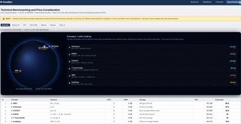
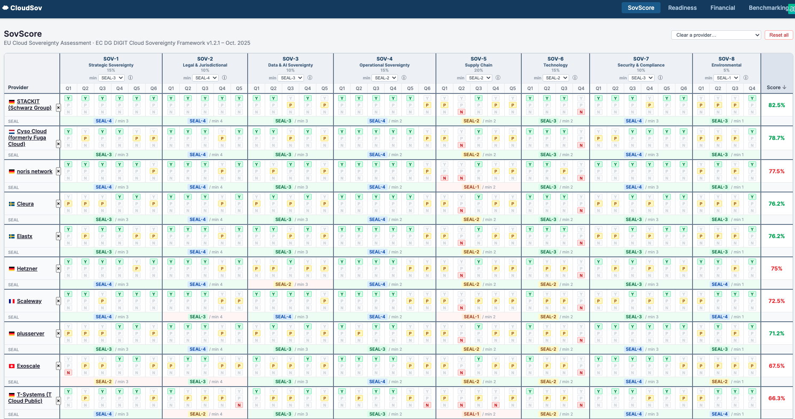
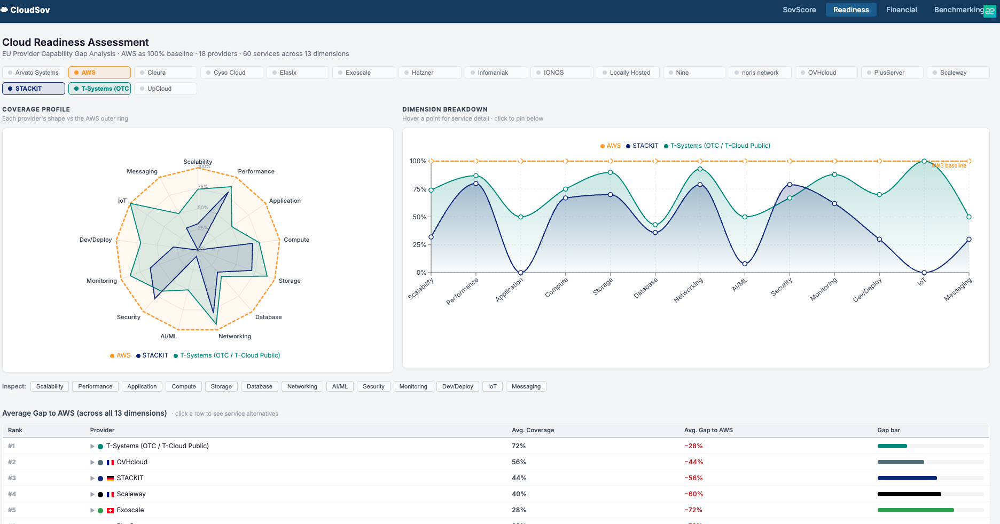
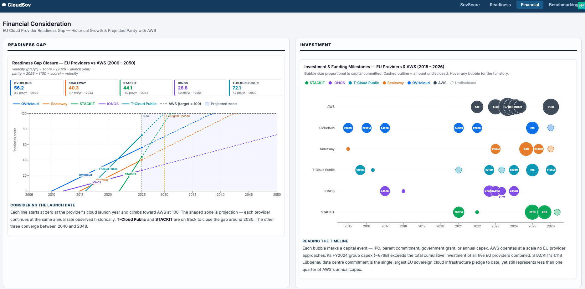
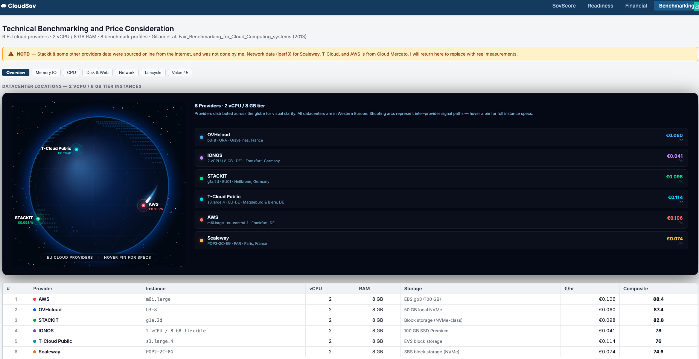

# CloudSov

**How sovereign is your cloud provider, really?**

CloudSov scores 17 European cloud providers against the European Commission's Cloud Sovereignty Framework, checks how well they can replace AWS services, compares their financial strength, and benchmarks their performance. It turns the research from my master's thesis into an interactive tool for enterprises choosing a European cloud.

> Hosted on Render's free tier: the first load after a quiet period can take up to a minute while the API wakes up.



## Why this exists

European companies running on US hyperscalers face a legal conflict. The GDPR and the Schrems II ruling restrict transfers of personal data to countries without adequate protection, while US laws such as the CLOUD Act and FISA Section 702 can compel US providers to hand over data regardless of where it is stored.

Many providers now market a "sovereign cloud", but the term means very different things. CloudSov makes sovereignty measurable and evidence-based, and puts it next to the practical questions an enterprise also has to answer: can this provider run my workloads, is it financially stable, and how fast is it?

## What it does

CloudSov is organised into four studies, each with its own page.

| Study | Question it answers | What you see |
| --- | --- | --- |
| **Sovereignty Score** | How sovereign is each provider? | Scores for 17 providers across 8 sovereignty objectives, with the evidence and source behind every answer |
| **Readiness Assessment** | Can it replace AWS? | Coverage of 60 AWS services across 11 domains, with the provider's equivalent service or the gap |
| **Financial Consideration** | Is it financially viable long term? | Revenue history, growth, investment and IPCEI-CIS participation for major providers |
| **Benchmarking** | How does it perform? | Phoronix Test Suite and network results for 5 EU providers against AWS, with price per hour |

### Sovereignty Score



### Readiness Assessment



### Financial Consideration



### Benchmarking



## How the sovereignty score works

The scoring follows the **European Commission (DG DIGIT) Cloud Sovereignty Framework v1.2.1** (October 2025). Each provider is assessed on 41 questions across 8 objectives:

| Objective | Weight | Minimum seal |
| --- | --- | --- |
| SOV-1 Strategic Sovereignty | 15% | 3 |
| SOV-2 Legal & Jurisdictional | 10% | 4 |
| SOV-3 Data & AI Sovereignty | 10% | 3 |
| SOV-4 Operational Sovereignty | 15% | 2 |
| SOV-5 Supply Chain | 20% | 2 |
| SOV-6 Technology | 15% | 2 |
| SOV-7 Security & Compliance | 10% | 3 |
| SOV-8 Environmental | 5% | 1 |

1. **Answers:** each question is answered *Yes* (2 points), *Partial* (1) or *No* (0), backed by a written note and a public source.
2. **Seals:** each objective's share of points maps to a sovereignty seal from 0 (no sovereignty) to 4 (full digital sovereignty), in steps of 20%.
3. **Total score:** seals are weighted by objective into a score from 0 to 100.
4. **Pass or fail:** a provider passes only if it reaches the minimum seal on every objective. Minimum seals are adjustable in the UI, so you can apply your own organisation's risk tolerance and rescore all providers instantly.

## Key findings

*Preliminary results; the thesis is still in progress.*

- **STACKIT (Schwarz Group)** ranks highest with a sovereignty score of **82.5**, followed by Cyso Cloud (78.8) and noris network (77.5).
- Only **5 of 17 providers** meet the minimum seal on every objective under the default thresholds.
- High overall scores don't guarantee a pass: noris network and Hetzner score above 75 but fail at least one minimum seal.

## Benchmark methodology

- **Providers:** STACKIT, IONOS, OVHcloud, Scaleway, T Cloud Public, with AWS (m6i.large) as baseline
- **Instances:** comparable 2 vCPU / 8 GB machines on Ubuntu 22.04 LTS
- **Profiles:** memory bandwidth (`pts/stream`), single-core CPU (`pts/hint`), compression (`pts/compress-7zip`), file system I/O (`pts/postmark`), web serving (`pts/apache`), network throughput (`iperf3`), boot time and setup time
- **Rigour:** at least 3 runs per profile, standard deviation below 2.5%, up to 40 runs for stability

Full details are in [`benchmarking/BENCHMARK_PLAN.md`](benchmarking/BENCHMARK_PLAN.md).

## Tech stack

| Layer | Technology |
| --- | --- |
| Backend | Python, FastAPI, Pydantic |
| Frontend | React, Vite, React Router, Recharts |
| Data | Versioned JSON files, one per provider and study |
| Hosting | Render (API as web service, frontend as static site) |

## API

| Method | Endpoint | Returns |
| --- | --- | --- |
| GET | `/api/framework` | Objectives, questions, weights and seal definitions |
| GET | `/api/providers` | Provider answers, evidence and initial scores |
| POST | `/api/score` | Rescored results for custom minimum seals |
| GET | `/api/readiness` | AWS service coverage per provider |
| GET | `/api/financial` | Financial indicators per provider |
| GET | `/api/revenue` | Revenue time series |
| GET | `/api/benchmarks` | Benchmark results |

Interactive API docs are available at `/docs` when the backend is running.

## Getting started

**Prerequisites:** Python 3.10+ and Node.js 18+

```bash
git clone https://github.com/aaeu-ihono/cloudsov-tool.git
cd cloudsov

# Backend
cd backend
python -m venv .venv
source .venv/bin/activate        # Windows: .venv\Scripts\activate
pip install -r requirements.txt
cd ..

# Frontend
cd frontend
npm install
cd ..

# Run both
./run.sh
```

- Frontend: http://localhost:5173
- API docs: http://localhost:8000/docs

## Project structure

```
cloudsov/
├── backend/              # FastAPI app: scoring logic and API endpoints
├── frontend/             # React app (Vite)
├── sovscore/             # Sovereignty answers and evidence, one file per provider
├── readiness/            # AWS service coverage, one file per provider
├── financial/            # Financial data per provider
├── financial_research/   # Research notes behind the financial data
├── benchmarking/         # Benchmark plan and results
├── screenshots/          # Images used in this README
├── render.yaml           # Render deployment blueprint
└── run.sh                # Starts backend and frontend locally
```

## Adding a provider

1. Add `sovscore/sov_<provider>.json` with an answer, note and source for each of the 41 questions.
2. Add `readiness/readiness_<provider>.json` with coverage for the AWS services.
3. Restart the backend; files are loaded automatically.

## Research context

CloudSov is part of my master's thesis at Technische Hochschule Rosenheim, *Achieving Data Sovereignty for EU Enterprises Through European Cloud Infrastructure*, carried out with Alps Alpine as industry partner.

## Limitations

- Scores reflect publicly available information at the time of assessment. Ownership, infrastructure and contract terms change, so results should be re-verified before decisions.
- Benchmarks capture one instance type per provider at a point in time.
- CloudSov supports decision-making but is not legal advice.

## Author

**Ihonosetale Oseghale** · 